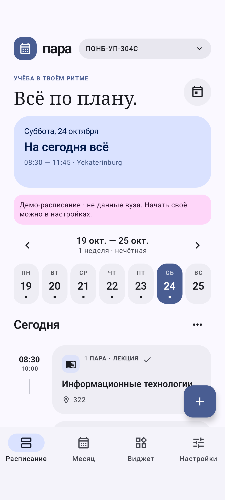
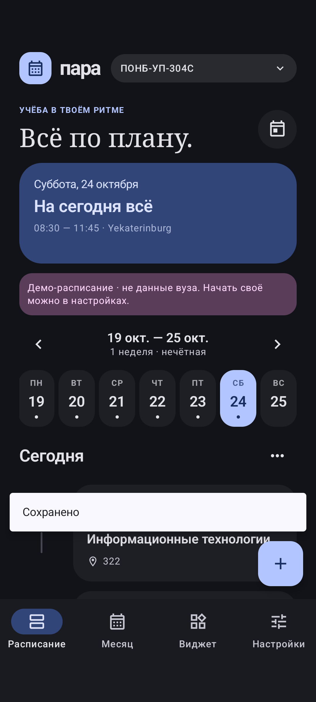
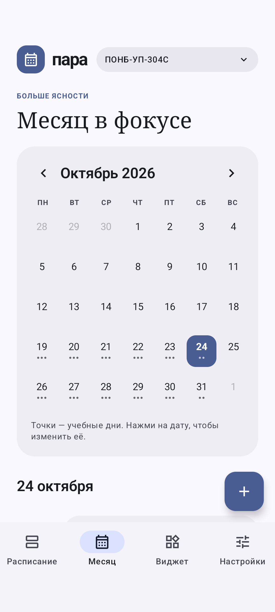

# пара

**Учёба — в своём ритме.** Отдельное Android-приложение с расписанием и виджетом для любой студенческой группы.

[Скачать APK](https://github.com/luwili/para-android/releases/latest/download/Para.apk) · [Релизы](https://github.com/luwili/para-android/releases) · [План импорта](docs/import-roadmap.md) · [Проверки](docs/testing.md)

> Ранняя версия. Не подключена к ИСУ университета и не загружает актуальное расписание ПОНБ-УП-304С. Встроенный пример — **демонстрационные данные**, включается только по запросу.

<p>
  
  
  
</p>

[Виджет и приложение при крупном шрифте](docs/screenshots/adaptive/overview.png) · [Широкое окно / боковая навигация](docs/screenshots/adaptive/wide.png)

## Уже работает

- Интерфейс на Jetpack Compose: светлая/тёмная тема, Material You (по умолчанию на Android 12+ для новых профилей) и отдельная лавандовая палитра по выбору.
- Собственная группа, часовой пояс IANA и учебный период. Для Уфы — `Asia/Yekaterinburg`.
- Редактор: предмет, время, аудитория/ссылка, преподаватель, тип занятия, цвет.
- Повторение каждую неделю или по чётным/нечётным неделям.
- Календарь месяца: разовые занятия, изменение времени и предметов, отмена всех пар на выбранную дату, возврат шаблона.
- Экспорт/импорт JSON через системный выбор файла. Сначала проверка формата и подтверждение замены.
- Адаптивный виджет: компактные строки, колонки и карточки. Показываются только целые карточки без обрезанных рамок; кабинет и другие подробности скрываются, если места недостаточно.
- Адаптивное приложение: перенос элементов при большом шрифте, боковая навигация на широких окнах, диалоги Material 3 в цветах выбранной темы.
- Воскресенье без занятий показывает следующий понедельник; реальные воскресные пары не скрываются.
- Полностью офлайн. Нет аккаунтов, аналитики, рекламы и разрешения `INTERNET`.

## Как пользоваться

1. Создайте группу. Выберите часовой пояс и понедельник первой учебной недели.
2. Нажмите «+». Выберите повторение. Недельный шаблон действует в заданном учебном периоде.
3. Для изменений конкретного дня откройте дату в календаре и выберите «Только дата». Это полная замена дня; будущие изменения шаблона не затронут такое исключение.
4. Через меню дня можно отменить все пары или вернуть недельный шаблон.
5. В настройках нажмите «Экспорт» и отправьте файл группе. Другие студенты смогут импортировать его в Пару.
6. В разделе «Виджет» нажмите «Добавить виджет» или добавьте вручную через рабочий стол → Виджеты → Пара. Удерживайте для изменения размера.

Сейчас на устройстве одно расписание. Обмен файлами — **не облачная синхронизация**. Импорт заменяет текущее расписание после подтверждения; перед этим рекомендуется экспортировать копию. Перед удалением приложения также сохраните JSON: системный бэкап отключён ради приватности.

Пример поддерживаемого формата — [`docs/example-schedule.json`](docs/example-schedule.json). Старый JSON сайта автоматически не преобразуется.

## Виджет и точность времени

Все размеры заполняются напрямую через `RemoteViews`, без `ListView`, коллекционного адаптера и прокрутки внутри виджета. Карточки делят доступное место; расчёт использует размер виджета и реальные метрики системного шрифта. Поэтому первая и последняя карточки не могут оказаться наполовину за границей прокручиваемого списка. Поведение отдельных лаунчеров всё равно требует проверки на устройствах.

Пара подсвечивается в интервале **[начало, конец)** по часовому поясу группы. После сохранения виджет обновляется сразу, в фоне — через WorkManager (запрос раз в 15 минут) и AppWidget Framework (раз в 30 минут). Android/Doze/MIUI могут задерживать фоновые задачи: это **не поминутный таймер**. Кнопка ↻ пересчитывает статус вручную. Exact Alarms и постоянный foreground-service не используются.

Виджет показывает столько целых карточек, сколько помещается. Сначала убираются второстепенные поля, затем ограничивается число строк названия; оставшиеся занятия обозначаются «Ещё N». В ультранизком варианте остаются начало пары и аббревиатура. Полное расписание и все подробности доступны по нажатию на виджет. Учитывается увеличенный системный шрифт.

На Android 12+ цвета обоев можно включить в настройках приложения. Явный выбор палитры в существующем профиле сохраняется при обновлении.

## Сборка

Android 8.0+ (`minSdk 26`), `compileSdk/targetSdk 35`, Kotlin 2.0.21, Compose, AGP 8.7.3, Gradle Wrapper 8.9, JDK 17.

```bash
# Установите JDK 17 и Android SDK; укажите sdk.dir в local.properties
./gradlew testDebugUnitTest lintDebug assembleDebug
# app/build/outputs/apk/debug/app-debug.apk
```

Для подписанного release задайте `PARA_KEYSTORE_FILE` (абсолютный путь к JKS), `PARA_KEYSTORE_PASSWORD`; alias ключа — `para`. Затем `./gradlew assembleRelease`. Без этих переменных release будет неподписанным. Debug и release имеют разные подписи: нельзя установить один поверх другого. Готовые APK в GitHub Releases используют один постоянный release-ключ.

CI проверяет тесты и lint; при push в `main` публикует APK. Для другого репозитория нужны GitHub Secrets `PARA_KEYSTORE_BASE64` и `PARA_KEYSTORE_PASSWORD`. Сам ключ никогда не должен попадать в Git.

Локальная копия release-ключа и пароля хранится в игнорируемой папке `.tools/signing/`. Владельцу проекта стоит сделать её зашифрованную резервную копию: без исходного ключа нельзя сохранить совместимость обновлений. Никогда не прикладывайте эту папку к issue или релизу.

Дополнительные UI/RemoteViews-тесты на подключённом устройстве или эмуляторе: `./gradlew connectedDebugAndroidTest`. Они используют и заменяют тестовое расписание установленной debug-версии; запускайте на отдельном тестовом устройстве, не на личных данных.

## Структура

```text
app/src/main/java/app/para/schedule/
  data/       # модель, календарная логика, JSON, атомарное хранение
  ui/         # Compose-экраны, редакторы и тема
  widget/     # адаптивные RemoteViews, WorkManager
  MainActivity.kt
  ParaViewModel.kt
app/src/test/ # тесты недель, дат, чётности, времени, редактора и JSON
docs/        # архитектура и план автоимпорта
```

Шрифты — системные Android sans/serif, без копирования проприетарных шрифтов. Старое приложение `Study_room_gemini` не изменяется и не является зависимостью этого проекта.
